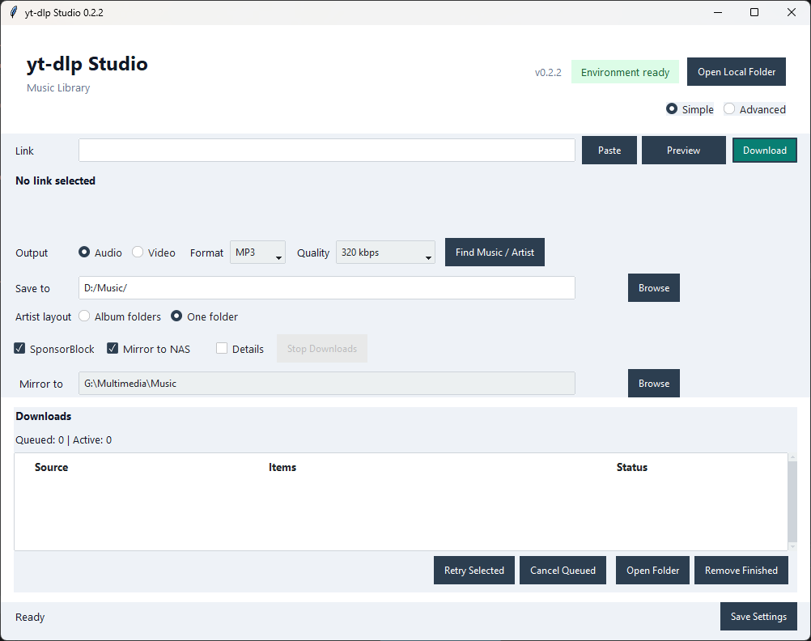
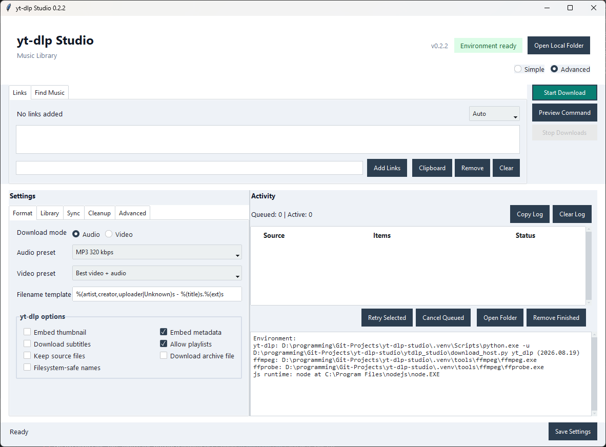

# yt-dlp Studio

A Windows utility for downloading music and video, reviewing Spotify artist releases, and optionally mirroring your library to a NAS. One queue, a simple default view, and advanced controls when you need them.

Version: **0.2.2**. Distributed as a **source zip**, not a standalone executable.

**Release status:** private prerelease testing. Version 0.2.2 includes setup, JavaScript-runtime detection and launcher feedback improvements. Backend availability and full-discography downloads still need real-world acceptance.

## See It In Action

The Simple view keeps the common paste, preview and download flow visible at a
glance. Advanced mode exposes detailed format, library, sync, cleanup and
diagnostic controls without changing the same download queue.

### Simple View

### Advanced View

## Get Started

1. Install **Python 3.10 or newer** for Windows (64-bit).
2. Extract the **whole release zip** into a permanent folder.
3. Double-click **`Setup.cmd`**. Choose whether to include Spotify support. Setup creates a local `.venv`, installs dependencies and FFmpeg/ffprobe, and adds Desktop/Start Menu shortcuts. Internet access is required.
4. Open **yt-dlp Studio** from a shortcut, or double-click **`yt-dlp-studio.vbs`**.

Setup shows progress and waits before closing. Normal app launches do not leave a terminal open. No administrator privileges are normally needed.

For YouTube, also have **Deno or Node.js 22+** on PATH. Interactive setup can optionally install Deno through WinGet when neither is found; see [troubleshooting](docs/troubleshooting.md).

## Download Something

1. Paste a link, or open **Find Music / Artist** and search.
2. Choose Audio/Video, Format, Quality and **Save to**.
3. Click **Download**. Track progress in the queue; retry a failed job without redoing successful ones.

Spotify support accepts tracks, albums, playlists and artist links. To review an artist's catalogue, search Spotify artists and open **Browse Discography**. Select releases or download the visible collection. Spotify supplies metadata; spotDL finds matching audio elsewhere, not from Spotify's audio stream.

**SponsorBlock** removes community-tagged sponsors, outros and non-music sections when available. **Mirror to NAS** is optional: downloads finish locally first, then completed files are copied to the matching destination folder.

## Library Controls

- **Simple / Advanced:** the same queue and settings, with more controls in Advanced.
- **Archives:** optional per-provider history skips previously completed URLs.
- **Duplicate review:** inspect possible matches across downloaders. Automatic cleanup only moves byte-identical files; nothing is permanently deleted.
- **Search:** request 25, 50 or 100 results and use **Load More**.
- **Artist layout:** choose Album folders or One folder in Simple, Advanced or the artist browser; mirror the same layout.

Read the [user guide](docs/user-guide.md) for mirroring, duplicate safety, editions and quality limits.

## Help And Updates

- [Troubleshooting and updates](docs/troubleshooting.md)
- [CLI examples](docs/cli.md)
- [Changelog](CHANGELOG.md)
- [Development and tests](docs/development.md)
- [Release checklist](docs/release.md)
- [Discovery implementation notes](docs/music-discovery.md)

Settings live in `%APPDATA%\ytdlp-studio`, outside the app folder. Downloads go to your chosen library. Keep cookies, credentials and personal libraries out of Git.

To update, close the app, extract the new release over its existing folder, then run `Setup.cmd` again. Do not move an installed `.venv`; see the repair instructions if you relocate the app.

Use only material you have permission to download. Source code is provided under the [MIT license](LICENSE); external services and dependencies have their own terms and licenses.
